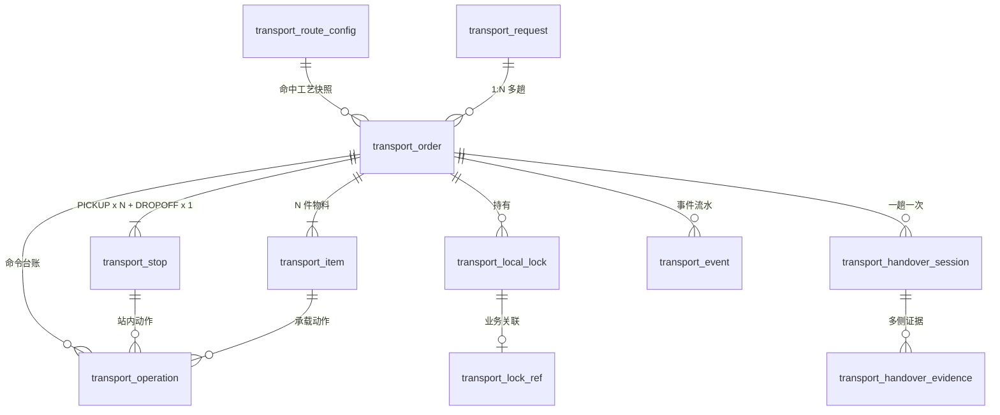
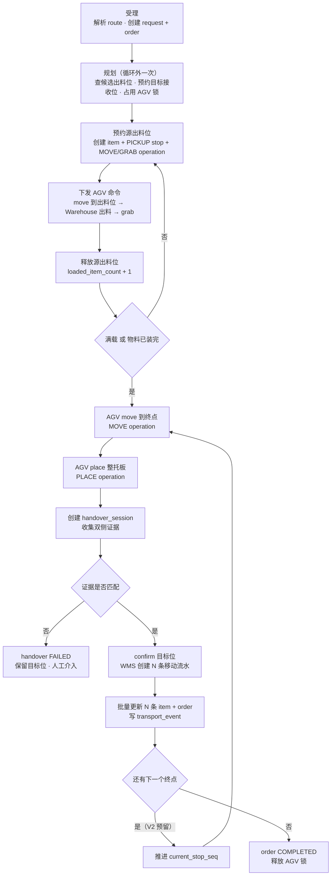

# Transport V1.0 收敛方案（点对点 · 多件装载 · 托板模式）

> 状态：待评审
> 替代：[transport-ddl-review.md](./transport-ddl-review.md) 第 4 节运行时主链路、以及 `doc/08` 第十二节的 Transport V1.0 实施顺序
> 配套 DDL：`sql/mysql/transport-v1-slim.sql`
> 旧脚本 `sql/mysql/transport-v1.sql` 保留为历史参考，不再执行

---

## 1. 前提与已定决策

| # | 约束 / 决策 | 结论 |
| --- | --- | --- |
| D1 | 驱动模型 | **Flow 是唯一推进器**。Transport 不跑后台调度、不做超时判定、不做重试编排 |
| D2 | 执行载体 | V1 只有一台 AGV；多 AGV 时路线不冲突，不需要路权与路段锁 |
| D3 | 场地 | 单厂区，不做 site 维度；`tenant_id` 即现场（表注释已写明） |
| D4 | 运输形态 | 点对点（单起点区域 → 单终点），多站点停靠 V1 不实现 |
| D5 | 槽位归属 | **槽位互斥归 WMS**（`TransportWmsApi`），因为出入口只有一个物理位，只有知道物理拓扑的一方能仲裁 |
| D6 | route 与 flow | **解绑**。route 只描述工艺，Flow 定义以 `routeCode` 作为启动参数引用 |
| D7 | 装载粒度 | **一趟多件物料**（多批次装载）；每趟一个物料的模型被否决 |
| D8 | 载具形态 | **托板模式**：AGV 自带托板（工装），N 件物料装到同一托板上，`place` 一次、`handover` 一次 |
| D9 | 多终点 | **预留不实现**：`transport_stop` 允许多条 DROPOFF，`transport_order.current_stop_seq` 负责推进 |

### D7 + D8 带来的模型结论

- 一趟 = 一个 `transport_order`，装 N 件 = N 条 `transport_item`
- `place` 一次（整托板放下），所以 `handover_session` 一趟一条
- WMS 侧产生 **N 条移动流水**（每件物料一条），逐条记在 `transport_item.last_movement_id`
- `transport_stop`：PICKUP 每轮一条（每轮换一个出料位），DROPOFF 只一条
- `transport_operation`：每轮 MOVE + GRAB 各一条，最后 MOVE + PLACE 各一条

### D1 带来的模型结论

- `transport_operation` 降级为**命令台账**：只记录「发了什么命令、结果如何、关联哪个 device_command_id」，状态只有 PENDING / SENT / SUCCEEDED / FAILED / SKIPPED
- 重试、超时、跳过全部由 Flow 节点负责，`attempt` / `max_attempts` / `timeout_at` 字段保留但只做记录，不驱动逻辑
- 没有后台 sweeper，所以 `transport_local_lock` 的过期回收改成**惰性清理**：`acquire` 时先 `UPDATE ... SET status='EXPIRED' WHERE status='ACTIVE' AND expire_at < now`

---

## 2. 领域模型

### 2.1 表清单（11 张）

| 表 | 职责 | 层级 |
| --- | --- | --- |
| `transport_route_config` | 静态工艺模板：动作能力键、载荷能力、托板类型、门禁 | 配置 |
| `transport_request` | 运输需求（1 个需求可拆 N 趟） | 业务 |
| `transport_order` | 一趟执行（装载计数、当前轮次、进度状态） | 执行 |
| `transport_item` | 托板上的 N 件物料（位置信息只在这里） | 执行 |
| `transport_stop` | 位置序列：PICKUP × N + DROPOFF × 1 | 执行 |
| `transport_operation` | 命令台账：MOVE / GRAB / PLACE / 开关门 | 执行 |
| `transport_local_lock` | 本地资源锁（仅 AGV / 门禁 / 机台接口 / 充电桩） | 资源 |
| `transport_lock_ref` | 运输单与锁的关联（业务维度） | 资源 |
| `transport_handover_session` | 双边交接会话（一趟一次） | 交接 |
| `transport_handover_evidence` | 交接证据（只增不改） | 交接 |
| `transport_event` | 事件流水 + Outbox | 审计 |

### 2.2 关系



### 2.3 三条不能破的建模纪律

1. **`order` 上不存 `source_slot_id` / `target_slot_id`**。位置只在 `item` 上。违反这条，多起点多终点永远做不了。
2. **`stop_seq` 分段编码**：PICKUP 用 `10/20/30`（`cycle_no * 10`），DROPOFF 从 `900` 起。留出插入空间，避免重排时改主键。
3. **`item` 是位置与物料的唯一载体**，`order` 只表达「这一趟的进度」。进度用 `loaded_item_count / target_item_count` 表达，不用状态细分。

---

## 3. 执行流程（可执行版本）

相比原流程图的 8 处修正：

| # | 原图问题 | 修正 |
| --- | --- | --- |
| 1 | DROPOFF stop 在循环体内，N 轮创建 N 条 | DROPOFF 移到循环外（规划阶段一次建好） |
| 2 | `local_lock` 每轮重建，第二轮锁自己 | AGV 锁在规划阶段建一次，循环内只续租 |
| 3 | 终点接收位每轮重查，可能拿到不同位 | 规划阶段查一次并预约，全程复用 |
| 4 | 「AGV move 到起点」每轮执行，第二轮空驶 | 每轮的 move 目标是「下一个出料位」，已在位则跳过 |
| 5 | WMS 流水 / item 更新按单数画 | 明确为 N 条（批量） |
| 6 | 失败出口只有一个 | 按阶段拆补偿（见第 6 节） |
| 7 | 缺终点接收位释放 | 交接成功后 `confirmTransferSlot` + 释放 |
| 8 | 缺 order 完成收口 | 全部 item DELIVERED → order COMPLETED |



### 每轮的关键判定

**满载判据**（节点 `decide_continue`）：

```text
continueLoading = (order.loaded_item_count < order.target_item_count)
                  AND (order.loaded_item_count < route.agv_load_capacity)
```

两个条件取与：目标是装 N 件，但车只能装 M 件时，装到 M 件就先走一趟。
这个判定由 Transport 提供命令 API 返回，不由 Flow 表达式硬编码——因为 `target_item_count` 与 `agv_load_capacity` 的取值逻辑属于领域知识。

---

## 4. 状态机

### 4.1 `transport_request`

| 当前 | 事件 | 下一状态 |
| --- | --- | --- |
| CREATED | 执行单创建成功 | ACCEPTED |
| ACCEPTED | 首个 order 进入 EXECUTING | EXECUTING |
| EXECUTING | 全部 order COMPLETED | COMPLETED |
| EXECUTING | 任一 order FAILED 且无重试 | FAILED |
| CREATED / ACCEPTED | 取消 | CANCELLED |

### 4.2 `transport_order`

| 当前 | 事件 | 下一状态 |
| --- | --- | --- |
| CREATED | AGV 锁获取成功 + 命令下发 | DISPATCHED |
| DISPATCHED | 首个 GRAB 成功 | EXECUTING |
| EXECUTING | 部分 item DELIVERED（多终点） | PARTIALLY_COMPLETED |
| EXECUTING / PARTIALLY_COMPLETED | 全部 item DELIVERED 且 handover CONFIRMED | COMPLETED |
| 任意非终态 | 不可恢复失败 | FAILED |
| CREATED / DISPATCHED | 取消（未装料） | CANCELLED |
| EXECUTING | 取消请求 | **拒绝**（已装料，只能走失败或返程） |

### 4.3 `transport_item`

| 当前 | 事件 | 下一状态 |
| --- | --- | --- |
| WAITING | GRAB 成功 | ON_AGV |
| ON_AGV | handover CONFIRMED 且 WMS 落库 | DELIVERED |
| WAITING / ON_AGV | 不可恢复失败 | FAILED |

### 4.4 `transport_stop`

`PENDING → TRAVELLING → ARRIVED → OPERATING → COMPLETED`，异常分支 `SKIPPED` / `FAILED`。

### 4.5 `transport_handover_session`

| 当前 | 事件 | 下一状态 |
| --- | --- | --- |
| CREATED | 开始收集证据 | VERIFYING |
| VERIFYING | 双侧证据全部匹配 | CONFIRMED |
| VERIFYING | 证据不匹配 / 超时 | FAILED |

砍掉了原方案的 `INCONSISTENT` / `MANUAL_CONFIRMED` / `ROLLED_BACK`：前两个没有人工入口，第三个没有回滚动作定义。人工介入统一走「handover FAILED + order 置 FAILED + 人工在后台改 item 状态」。

---

## 5. Flow 节点契约

替代现有 6 个硬编码测试桩。**所有节点必须可重复执行且结果一致**（Flow 会重试）。

| 节点 | 入参 | 出参 | 幂等键 | 建议超时 |
| --- | --- | --- | --- | --- |
| `transport.accept` | sourceType, sourceRef, routeCode, items[].{materialInstanceId, sourceSlotId, targetSlotId}, transportMode | orderId, orderNo, targetItemCount, agvLoadCapacity | `{sourceRef}` 或调用方 `idempotencyKey` | 10s |
| `transport.plan` | orderId | targetSlotId, candidateSlots[], lockToken | `{orderNo}:PLAN` | 10s |
| `transport.reserve_source` | orderId, cycleNo, slotId | reservationKey, itemId, stopId | `{orderNo}:{cycle}:SRC` | 5s |
| `transport.load_item` | orderId, cycleNo, itemId, actionKeys | loadedCount, deviceCommandId | `{orderNo}:{cycle}:GRAB` | 120s |
| `transport.release_source` | slotId, reservationKey | released | `{orderNo}:{cycle}:REL_SRC` | 5s |
| `transport.decide_continue` | orderId | continueLoading, reason | `{orderNo}:{cycle}:DECIDE` | 5s |
| `transport.travel` | orderId, targetSlotId | arrived, deviceCommandId | `{orderNo}:TRAVEL` | 300s |
| `transport.unload` | orderId, targetSlotId | handoverId, placeCommandId | `{orderNo}:PLACE` | 120s |
| `transport.verify_handover` | handoverId | matched, evidenceIds[] | `{handoverNo}:VERIFY` | 30s |
| `transport.commit_wms` | orderId, handoverId | movementBatchNo, movementIds[] | `{handoverNo}:COMMIT` | 30s |
| `transport.release_all` | orderId, reason | released[] | `{orderNo}:RELEASE_ALL` | 10s |

设计约束：

- `transport.commit_wms` 是**唯一允许重放**的节点。`handover_session.verified_at` 已落库，重放只补 WMS 落库，不重复采集证据。
- `transport.load_item` 重试前必须先查 `transport_operation` 里 `{orderNo}:{cycle}:GRAB` 是否已有 `device_command_id`，有则只轮询不重发。
- `transport.release_all` 是补偿节点，必须幂等（已释放的 reservationKey 再释放不报错）。

---

## 6. 补偿矩阵

| 场景 | 资源处理 | 单据状态 | 是否需要人工 |
| --- | --- | --- | --- |
| 源位预约失败（候选为空） | 无占用 | order FAILED | 否 |
| 目标位预约失败 | 释放已占 AGV 锁 | order FAILED | 否 |
| 出料失败 | 释放源位 + AGV 锁 | item FAILED，order FAILED | 否 |
| GRAB 失败 | 保留源位预约（物料还在原位） | item FAILED，order FAILED | 是（确认物料状态） |
| 满载后 MOVE 终点失败 | 释放目标位，保留 AGV 锁至人工确认 | order FAILED，已装 item 保持 ON_AGV | 是（AGV 带料原地） |
| PLACE 失败 | 保留目标位 LOCKED | order FAILED | 是 |
| 证据不匹配 | 保留目标位 LOCKED | handover FAILED，order FAILED | 是 |
| **交接成功、WMS 落库失败** | 目标位保持 LOCKED，`handover.verified_at` 保留 | handover CONFIRMED，order EXECUTING（可重放 commit） | 否，自动重试 |
| 部分 item 交付（多终点） | 已交付的释放对应位 | order PARTIALLY_COMPLETED | 视业务 |
| 未装料时取消 | 逆序释放全部 reservation + 锁 | order CANCELLED | 否 |
| 已装料时取消 | 拒绝，或走「原地返程」（V1 不实现） | order 不变 | 是 |

---

## 7. 字段变更清单（相对 transport-v1.sql）

| 表 | 变更 | 原因 |
| --- | --- | --- |
| `transport_request` | 删 `execution_id` | flow 执行号由 `source_type + source_ref` 承载，避免硬编码流程域外键 |
| | `transport_mode` 改为三值语义锚点 | SINGLE / SAME_DESTINATION / MILK_RUN 对应三种装载形态 |
| `transport_order` | 加 `sequence_no` | 一个需求拆多趟时的执行顺序 |
| | 加 `target_item_count` / `loaded_item_count` | 装载完成与满载判据 |
| | 加 `current_cycle_no` | 当前轮次，幂等键组成部分 |
| | 加 `route_code` / `plate_type` | 工艺与托板快照 |
| | `plan_version` 保留 | 重排时递增 |
| `transport_item` | 加 `load_cycle_no` | 这件是第几轮装上的 |
| | `status` 收为 4 态 | WAITING / ON_AGV / DELIVERED / FAILED |
| `transport_stop` | 加 `cycle_no` | PICKUP 轮次可追溯 |
| `transport_operation` | 加 `cycle_no`；状态收为 5 态 | 降级为命令台账 |
| `transport_local_lock` | `resource_type` 收为 4 类 | 槽位类归 WMS |
| | 加 `release_reason` | 原 API 传了 reason 却没地方存 |
| `transport_handover_session` | 删 `wms_movement_id`，加 `movement_batch_no` | N 件物料对应 N 条流水 |
| | 加 `verified_at` / `committed_at` | 支持「已确认未落库」的可重放中间态 |
| | 状态收为 4 态 | 去掉无实现的 3 个态 |
| `transport_handover_evidence` | **补 5 个审计列** | DO 继承 TenantBaseDO，缺列会拼出非法 SQL |
| `transport_lock_ref` | **补 5 个审计列** | 同上 |
| `transport_event` | **补 5 个审计列** | 同上 |
| `transport_route_config` | 删 `flow_definition_key` / `flow_definition_version` | 与 Flow 解绑 |
| | 加 `source_zone_code` / `target_zone_code`，站点改为可空 | 匹配键降级为类型/区域 |
| | `id` 改雪花（原 AUTO_INCREMENT） | 与全库 ID 策略一致 |

所有唯一键统一使用 guard 生成列（`IF(deleted=b'0', code, NULL)`），逻辑删除后编码可复用。

---

## 8. 多起点多终点的预留边界

**能支持（不改表、不改状态机）**

- 多起点 → 多趟：`request 1:N order`，每趟 `sequence_no` 递增，Flow 用 loop 节点串行推进
- 多件装载：`order 1:N item`，V1 已实现（这是 D8 的直接结果）
- 多终点 → 多 DROPOFF：`stop` 允许多条 `stop_seq=900/910/920`，`order.current_stop_seq` 推进

**需要新代码（不改表）**

- 多终点循环：`place` 之后回到 `travel`，`current_stop_seq` 推进
- 一条 route 覆盖多站点：靠「区域匹配」而非「站点匹配」

**需要改表（明确不做，也不预留字段）**

- 混装多种工艺（一条 order 同时用 AGV + 输送线）→ 需要 `order` 与 `route` 的多对多
- 路径优化 / 多点任务下发 → 需要 AGV 厂商支持多点任务接口，且 `stop` 序列要下发给 AGV

---

## 9. 未决假设

| # | 假设 | 若不成立的影响 |
| --- | --- | --- |
| A1 | 托板是 AGV 自带工装，不参与 WMS 库存 | 若托板需入库管理，`item` 要增加一行 loadUnit，或 `order` 增加 `load_unit_id` |
| A2 | 一趟只服务一个终点（V1） | 多终点按第 8 节预留方式扩展，不改表 |
| A3 | AGV 命令接口是「单点任务」（一次 move 到一个位，一次 grab/place） | 若厂商支持整单多点任务，`operation` 可合并，但表结构不变 |
| A4 | WMS 的 `TransportWmsApi.reserveTransferSlot` 会补上 `reservationKey` 落库与持有者校验 | 不补则释放可能误伤他人预约，`release` 无法校验持有者 |

---

## 10. 验收标准

1. 一次请求装 3 件物料，只产生 1 个 order、3 个 item、3 个 PICKUP stop、1 个 DROPOFF stop
2. 3 条 `transport_operation` 的 GRAB 命令幂等键互不相同，Flow 重试不产生第 4 条 GRAB
3. `loaded_item_count` 到达 `min(target_item_count, agv_load_capacity)` 时触发 MOVE 终点
4. 交接成功后 WMS 产生 3 条移动流水，逐条写回 `item.last_movement_id`
5. 第 4 条失败时，重复执行 `commit_wms` 不产生重复流水（幂等键 `{handoverNo}:COMMIT`）
6. 全流程结束后：所有 `reservationKey` 已释放、`transport_local_lock` 无 ACTIVE 记录、目标位不再是 LOCKED
7. 任意失败场景下，`transport_event` 能还原「哪一轮、哪一件、哪个动作」失败

---

## 11. 落地状态与代码同步清单

**已完成**

- `sql/mysql/transport-v1-slim.sql` 已在本地库 `boheng-frame` 执行，11 张表全部重建（原 10 张表均为空表，安全 DROP）
- 已验证：`transport_event` / `transport_handover_evidence` / `transport_lock_ref` 的 5 个审计列补齐，`SELECT ... WHERE deleted=0` 不再报 1054
- 已冒烟验证多件模型：1 order + 3 item（3 个不同起点、同一终点）写入与聚合查询正常

**代码侧必须同步（否则运行时会报错）**

| 文件 | 变更 | 不做会怎样 |
| --- | --- | --- |
| `TransportRouteConfigDO` | `@TableId(type = IdType.AUTO)` → `IdType.ASSIGN_ID` | 表 id 已去掉 auto_increment，插入报 `Field 'id' doesn't have a default value` |
| `TransportRequestDO` | 删 `executionId` 字段 | 字段在表中已不存在，查询 `SELECT *` 映射无害，但 update 会带出未知列 |
| `TransportOrderDO` | 加 `sequenceNo` / `routeCode` / `plateType` / `targetItemCount` / `loadedItemCount` / `currentCycleNo` | 读不到装载计数，满载判断失效 |
| `TransportItemDO` | 加 `loadCycleNo`；`status` 枚举改 4 态 | 轮次不可追溯 |
| `TransportStopDO` | 加 `cycleNo` | 同上 |
| `TransportOperationDO` | 加 `cycleNo`；状态 5 态 | 同上 |
| `TransportHandoverSessionDO` | 删 `wmsMovementId`，加 `movementBatchNo` / `verifiedAt` / `committedAt` | 交接落库状态无法表达 |
| `TransportLocalLockDO` | 加 `releaseReason` | release 的 reason 仍然丢弃 |

**下一步（按依赖顺序）**

1. 同步 DO 字段与 ID 策略（纯映射层，无业务逻辑）
2. 用 `TransportApiImpl` 实现契约，`TransportRequestService` 收敛为内部实现（解决契约无实现的问题）
3. 落地 11 个 Flow 节点（替换现有 6 个硬编码测试桩）
4. WMS 侧补 `reservationKey` 落库与持有者校验（假设 A4）
