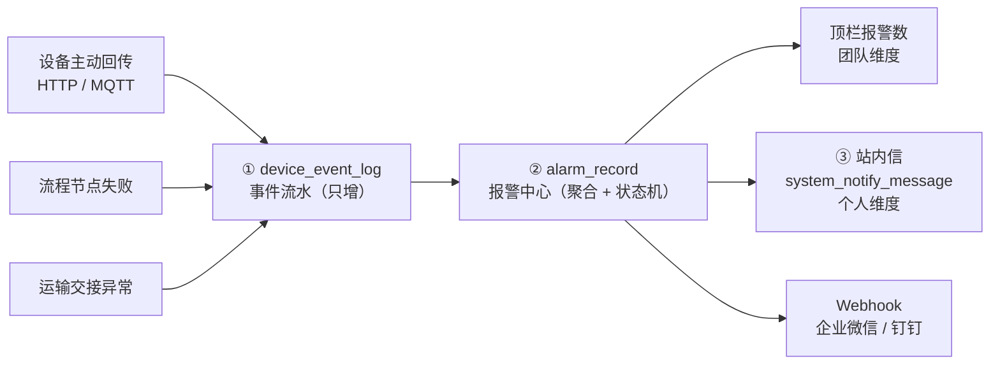

# 消息中心与设备报警设计

> 状态：待评审
> 范围：新增设备回传日志、设备报警、系统告警统一中心
> 结论：**现有站内信不推翻，需要补一层「报警实体」**

---

## 1. 先回答问题：要不要重新设计

**不用推翻，但必须补一层。**

现有 `system_notify_*`（芋道站内信）解决的是「一条消息发给某个人、他读没读」，这个问题它解决得挺好。但设备报警不是这个消息模型能装的——两者是不同物种：

| 维度 | 个人消息（notify_message） | 设备报警（alarm） |
| --- | --- | --- |
| 生命周期 | 发出去就结束，只剩「已读/未读」 | **持续存在**，直到设备恢复或人工关闭 |
| 数量语义 | 1 次事件 = 1 条消息 | 同一条报警重复 100 次 = **1 条记录 + 次数 100** |
| 归属 | 个人（`user_id`，一人一条） | **团队共享**（谁先看到谁处理） |
| 状态 | `read_status` 一个 bit | ACTIVE → ACKED → RECOVERED → CLOSED |
| 处置 | 无 | 确认人 / 确认时间 / 处置措施 / 误报关闭 |
| 放大风险 | 消息量可控 | 用 notify 存报警：10 个用户 × 1000 次上报 = **10000 行** |

所以设计上分两层：**报警是事实，通知是投递**。报警中心记录「现在有什么问题」，站内信只是「把这件事告诉某人」的一个渠道。

---

## 2. 现状盘点（四个硬事实）

| # | 事实 | 影响 |
| --- | --- | --- |
| 1 | `system_notify_message` 83 条数据全部是芋道 demo（`hrm_performance_task_pending`、`test`） | 现有站内信业务没用起来，改造无历史包袱 |
| 2 | `device_data_raw.command_id` 是 **NOT NULL** | 设备**主动**上报（无命令关联）根本没有落点 |
| 3 | `DeviceCallbackController` 必须带 `commandNo` / `X-Command-No` | 只能收「命令回调」，收不了「设备自己报警」 |
| 4 | 无 `alarm` 表、无设备事件表、无 SSE/WebSocket | 报警从入口到呈现全是空白 |

第 2、3 条是本次要解决的核心缺口：**设备报警通常是异步的、和命令无关的推送**（MQTT topic、设备 HTTP webhook、状态轮询发现异常），现有模型一律接不住。

---

## 3. 分层架构



三层职责：

| 层 | 表 | 职责 | 数据量级 |
| --- | --- | --- | --- |
| ① 事件流水 | `device_event_log` | 设备回传的**全部**原始事件，只增不改，可查可追溯 | 大（每天万级），按时间分区/归档 |
| ② 报警中心 | `alarm_record` + `alarm_code` + `alarm_action` | 聚合后的**当前问题清单**，有生命周期 | 小（同时活跃几十条） |
| ③ 投递 | `system_notify_message`（复用）+ Webhook | 告诉具体的人 / 推给外部系统 | 中 |

关键点：**①进②不是 1:1 映射**。同一条报警上报 1000 次，流水 1000 行，报警记录 1 行。

---

## 4. 数据模型

### 4.1 `device_event_log` 设备回传事件流水

不依赖 `command_id`，这是与 `device_data_raw` 的根本区别。

| 字段 | 说明 |
| --- | --- |
| `id` | 雪花 |
| `device_id` / `device_code` | 来源设备 |
| `event_type` | `ALARM` / `ALARM_RECOVER` / `ONLINE` / `OFFLINE` / `STATE_CHANGE` / `HEARTBEAT_MISS` |
| `event_code` | 厂商事件码，如 `E1023`（原样保留，不做翻译） |
| `event_level` | 原始等级（厂商给的，可能为空） |
| `event_message` | 原始描述 |
| `payload` | 完整原始报文 JSON |
| `occurred_at` | 设备侧发生时间（可能早于接收时间） |
| `received_at` | 平台接收时间 |
| `source` | `CALLBACK` / `MQTT` / `POLL` / `MANUAL` |
| `dedup_key` | 去重键（见 4.2） |
| `converted_alarm_id` | 已转成哪条报警（空表示未转，如普通状态上报） |

只增不改，不建 `update_time` 语义（但仍继承审计列以满足底座约定）。

### 4.2 `alarm_code` 报警码字典

| 字段 | 说明 |
| --- | --- |
| `source_type` | `DEVICE` / `FLOW` / `TRANSPORT` / `SYSTEM` |
| `source_key` | 设备类型码（DEVICE 时必填，如 `AGV`）；其他来源填模块名 |
| `code` | 报警码，如 `E1023` |
| `name` | 中文名，如「激光避障触发」 |
| `level` | `INFO` / `WARN` / `CRITICAL` / `EMERGENCY` |
| `ack_required` | 是否必须人工确认 |
| `suppress_seconds` | 抑制窗口（默认 300，同码在此窗口内不重复投递） |
| `advice` | 处置建议（显示在报警详情里） |
| `enabled` | 是否启用 |

**未登记的码不阻塞**：上报时按「`source_type` + `source_key` + `code`」查字典，查不到就用默认等级 `WARN` 并自动登记一条 `enabled=0` 的字典项（标记 `auto_created`），提示管理员补全名称和等级。这避免了「必须先把几百个厂商报警码配完才能收到报警」的死结。

### 4.3 `alarm_record` 报警实例（核心表）

一条记录 = 一段完整的报警生命周期。

| 字段 | 说明 |
| --- | --- |
| `alarm_no` | 报警编号 |
| `source_type` / `source_id` / `source_code` | 来源类型 / 来源主键 / 来源编码（设备编码、执行号、运输单号） |
| `alarm_code` / `alarm_level` / `alarm_name` | 码、等级（可被上报覆盖）、名称快照 |
| `status` | `ACTIVE` / `ACKED` / `RECOVERED` / `CLOSED` |
| `first_occurred_at` | 首次发生 |
| `last_occurred_at` | 最近一次发生 |
| `occur_count` | 累计发生次数 |
| `recovered_at` | 恢复时间 |
| `ack_required` | 是否需要确认 |
| `acked_by` / `acked_at` / `ack_note` | 确认人与备注 |
| `resolution_code` | 处置指令：`SKIP` / `RETRY` / `ABORT`（回传给设备或上游，见 4.6） |
| `resolution_by` / `resolution_at` | 下达处置指令的人与时间 |
| `resolved_pulled_at` | 设备/上游取走处置结果的次数与时间（防重复执行） |
| `closed_by` / `closed_at` / `close_reason` | 关闭人与原因（误报/已处理/忽略） |
| `suppressed_until` | 抑制截止时间（避免重复打扰） |
| `escalate_at` / `escalate_level` | 升级时间与等级（V2 预留，V1 不写） |
| `trigger_payload` | 首次触发的原始报文快照 |
| `last_event_id` | 最近一次对应的事件流水 |
| `duration_sec` | 持续时长（恢复时结算，便于统计） |

**唯一性靠生成列**：同一来源同一码，最多只允许一条「未结束」的记录。

```sql
`active_guard` varchar(200) GENERATED ALWAYS AS (
    IF(`deleted` = b'0' AND `status` IN ('ACTIVE','ACKED'),
       CONCAT(`source_type`, '#', `source_id`, '#', `alarm_code`), NULL)
) VIRTUAL,
UNIQUE KEY `uk_alarm_active` (`tenant_id`, `active_guard`)
```

这条约束是整个设计的支点：重复上报撞唯一键 → 转成 UPDATE 累加，天然实现聚合，不依赖应用层先查后写。

### 4.4 `alarm_action` 处置记录（只增）

`alarm_id` / `action_type`（`ACK` / `RESOLVE` / `CLOSE` / `TRANSFER` / `NOTE` / `ESCALATE`）/ `operator_id` / `operator_name` / `content` / `created_at`。

价值：报警「谁在什么时候干了什么」可追溯，比只在 `alarm_record` 上存一个 `acked_by` 强得多（同一条报警可能被转派两次、备注三条）。

### 4.6 处置指令回传（报警 → 处置 → 设备执行）

设备报警后往往停在原地等指令（「跳过这一步」还是「重试」），如果平台只在页面上标个「已处理」，设备永远不知道该干什么。所以要有一条回传通道：

```
设备上报报警 → 报警中心 ACTIVE → 人在页面选 跳过/重试
                                      ↓ 写 resolution_code
设备轮询 GET /app-api/alarm/resolution?sourceCode={deviceCode}&code={alarmCode}
                                      ↓ 返回 SKIP / RETRY / ABORT（取走后置 resolved_pulled_at）
设备执行动作
```

设计要点：
- **设备主动轮询**，不做平台反向调用设备（设备侧只需要一个 HTTP GET，不需要暴露端口）
- **取走即标记**：`resolved_pulled_at` 置位，同一处置结果只返回一次，避免设备重复执行
- 处置指令是**可选能力**：只有配置了 `alarm_code.device_waiting = 1` 的报警码才需要回传，普通报警（如温度超限）不阻塞设备
- 拒绝用「日志表字段塞语义」（参考实现的坑，见第 13 节）

### 4.5 个人消息：复用 `system_notify_message`

不新建表。报警需要「通知到人」时，调 `NotifyMessageService` 发一条站内信，`template_params` 里带 `alarmId`，前端点击跳转到报警详情。

---

## 5. 报警状态机

```
                    ┌──────────────┐
        上报 ──────► │    ACTIVE    │
                    └──────┬───────┘
                      ┌────┴────┐
              人工确认 │         │ 设备恢复
                      ▼         ▼
                 ┌────────┐  ┌───────────┐
                 │ ACKED  │  │ RECOVERED │
                 └───┬────┘  └─────┬─────┘
                     │ 设备恢复     │ 归档
                     ▼             ▼
                 ┌────────┐   ┌────────┐
                 │RECOVERED│  │ CLOSED │
                 └───┬────┘   └────────┘
                     │ 归档
                     ▼
                 ┌────────┐
                 │ CLOSED │
                 └────────┘
        任意态 ── 误报关闭 ──► CLOSED
```

| 迁移 | 触发 | 副作用 |
| --- | --- | --- |
| → ACTIVE | 首次上报（无活跃记录） | 写 event、按等级投递 |
| ACTIVE → ACTIVE | 重复上报 | `occur_count+1`、`last_occurred_at` 刷新，**不投递** |
| ACTIVE → ACKED | 人工确认 | 写 action、清空 `active_guard`（不再占用唯一键） |
| ACTIVE / ACKED → RECOVERED | 收到恢复信号 | 结算 `duration_sec`，发一条「已恢复」通知 |
| 任意 → CLOSED | 人工关闭（误报/已处理） | 写 action + 原因 |

**注意 ACKED 仍占用唯一键**：确认不等于恢复，同一报警后续再上报应继续累加在原记录上，而不是新开一条。

---

## 6. 关键机制

### 6.1 去重与聚合
靠 `uk_alarm_active` 唯一键。上报流程：

```text
INSERT alarm_record (status=ACTIVE) 
  ├─ 成功 → 新报警，投递
  └─ 唯一键冲突 → UPDATE occur_count+1, last_occurred_at=now
                  ├─ 距上次投递 < suppress_seconds → 不投递
                  └─ 超过抑制窗口 → 再次投递（提醒仍未处理）
```

### 6.2 抑制
三种抑制来源，取最晚的截止时间写进 `suppressed_until`：
- 报警码配置的 `suppress_seconds`
- 已确认（ACKED）的报警在 X 分钟内不重复推送（默认 30 分钟）
- 设备处于 `MAINTENANCE` 时，该设备所有 `WARN` 及以下报警不推送

### 6.3 恢复
两种方式：
- **显式**：设备回传 `ALARM_RECOVER` + 同码 → 关掉对应活跃记录
- **隐式**：同一设备连续 N 次状态轮询都没有该码（用于不支持恢复信号的厂商），由定时任务判定，默认关闭（V1 不做，预留）

### 6.4 升级（V2 预留）
`CRITICAL` 且未确认超过 15 分钟 → `escalate_level+1` + 通知上级。字段已留，V1 不实现，因为「通知谁」依赖组织架构配置，属于运维流程设计，不是技术问题。

### 6.5 误报处理
允许 `CLOSED` 且必须填 `close_reason`。同时给 `alarm_code` 一个「误报计数」，同一个码误报超过阈值时在字典页标红，提示调整阈值或停用。

---

## 7. 设备回传接入（新增入口）

现有 `POST /admin-api/device/callback/{commandNo}` 要求命令号，不适用于主动报警。新增：

```
POST /app-api/device/event/report          # 设备/网关主动上报
Header: X-Device-Code, X-Device-Token
Body: {
  "events": [
    { "type": "ALARM", "code": "E1023", "level": "CRITICAL",
      "message": "激光避障触发", "occurredAt": "2026-10-30T10:00:00", "payload": {...} },
    { "type": "ALARM_RECOVER", "code": "E1023", "occurredAt": "..." }
  ]
}
```

设计要点：
- **批量**：一次最多 50 条，减少设备侧 HTTP 压力
- **幂等**：`dedup_key = deviceCode + code + occurredAt` 唯一，重复推送不产生重复流水
- **不阻塞设备**：落库成功即返回 200，报警聚合异步（或同步但 try-catch 不外抛），避免设备因平台内部异常反复重推
- **租户**：`@TenantIgnore`，靠 `X-Device-Token` 认设备，和现有 callback 一致

MQTT 接入：Topic 约定 `device/{deviceCode}/event`，由现有 MQTT 客户端转调同一个 Service。

---

## 8. 各模块如何上报

统一契约（新建 `boheng-module-alarm-api`）：

```java
public interface AlarmApi {
    /** 上报一条报警（幂等：同来源同码只维护一条活跃记录）。 */
    Long report(AlarmReportReqDTO req);

    /** 上报恢复。 */
    void recover(AlarmRecoverReqDTO req);

    /** 关掉某来源的全部活跃报警（用于流程结束、设备下线等场景）。 */
    void recoverAll(AlarmSource source);

    /** 设备/上游取走处置指令（取走即标记，同一条只返回一次）。 */
    AlarmResolutionRespDTO pullResolution(String sourceType, String sourceCode, String alarmCode);
}
```

| 来源 | 调用点 | 报警码示例 |
| --- | --- | --- |
| device | 回调/事件入口解析出 ALARM | `E1023` 激光避障、`E2001` 通讯超时 |
| device | 心跳超时检测 | `DEVICE_OFFLINE` |
| flow | 节点失败、执行超时 | `NODE_FAILED`、`EXECUTION_TIMEOUT` |
| transport | 交接证据不匹配、交接超时 | `HANDOVER_MISMATCH`、`HANDOVER_TIMEOUT` |
| system | 定时任务失败、数据库连接池告警 | `JOB_FAILED` |
| device | 设备轮询取处置指令 | 见 4.6（反向：设备来取，不是上报） |

统一走 `AlarmApi`，各模块不直接写 `alarm_record`。

---

## 9. 前端「消息中心」

顶栏铃铛（`web/src/layout/components/Message`）扩展为三个区：

| 区域 | 数据 | 是否按人 |
| --- | --- | --- |
| **报警** | 未关闭的 `ACTIVE` / `ACKED` | 否，团队共享，显示总数 |
| **我的消息** | `system_notify_message` | 是，显示未读数 |
| **公告** | `system_notice` | 否 |

页面（新增 `web/src/views/alarm/`）：
- 报警看板：按等级/状态/设备/时间筛选，CRITICAL 置顶，支持批量确认
- 报警详情：原始报文、发生次数时间轴、处置记录、跳转设备详情
- 报警码字典：等级、抑制窗口、处置建议维护，自动登记的码标黄待补

实时性：**WebSocket 广播 + 轮询兜底**。框架已内置 `boheng-spring-boot-starter-websocket`（`WebSocketMessageSender`，支持 Local/Redis/RabbitMQ/Kafka 四种广播实现），不需要新建基建：报警产生时按 `CRITICAL` 推给在线会话，前端收到后刷新看板；同时保留 30 秒轮询 `/admin-api/alarm/active-count` 作为断线兜底。

---

## 10. 模块归属与 V1 范围

### 放哪里

**新建 `boheng-module-alarm` + `boheng-module-alarm-api`**，不塞进 device：
- 报警来源跨 device / flow / transport / system，塞进任何一个都会造成反向依赖
- 有独立前端页面与状态机，塞进 infra 会让 infra 越来越杂
- 与 `wms-api` / `device-api` 的模块习惯一致

代价：根 pom `<modules>`、`boheng-server/pom.xml` 各加一行，菜单 SQL 一段。

### V1 做什么

1. 4 张表：`device_event_log` / `alarm_code` / `alarm_record` / `alarm_action`
2. `AlarmApi`（report / recover / recoverAll）+ 内部 Service
3. 设备事件上报入口（HTTP 批量 + MQTT 转换）
4. 报警列表 / 详情 / 确认 / 关闭 / 字典维护 5 个接口
5. 顶栏报警数 + 报警看板页面
6. 投递：站内信（复用 notify）+ Webhook（可选）

### V1 不做什么

- 不做升级策略（字段预留）
- 不做根因分析 / 报警关联（一个故障引发 20 条报警的合并）
- 不做 per-user 已读（报警是团队的）
- 不做 SSE
- 不做报警统计报表（先有数据，后做分析）

---

## 11. 与现有资产的关系

| 现有 | 处理 |
| --- | --- |
| `system_notify_message` / `template` | **保留复用**，作为「通知到人」的渠道 |
| `system_notice` | 保留，进消息中心「公告」区 |
| `device_data_raw` | 保留原职责（命令响应报文，L0），**不塞报警** |
| `device_command` | 不变 |
| `transport_event` / flow 事件 | 不变，报警通过 `AlarmApi` 上报，不直接读它们的表 |

---

## 12. 验收标准

1. 设备连发 100 次 `E1023`，`device_event_log` 100 行，`alarm_record` **1 行**、`occur_count=100`
2. 同一报警在抑制窗口内不重复推送站内信；超过窗口仍 ACTIVE 时再次提醒
3. 设备回传 `ALARM_RECOVER` 后，报警自动 `RECOVERED`，`duration_sec` 正确结算
4. 人工确认后状态 `ACKED`，后续上报继续累加到同一条记录，不新开
5. 未登记的新报警码可正常报警（默认 WARN），并在字典页标记待补全
6. 设备处于 `MAINTENANCE` 时，WARN 级报警不推送，但仍记录
7. 报警关闭必须填原因，`alarm_action` 能还原完整处置链路
8. 站内信点击可跳转到对应报警详情（`template_params.alarmId`）

---

9. 设备轮询处置接口，同一条处置结果只返回一次（`resolved_pulled_at` 置位后不再返回）
10. CRITICAL 报警产生后 3 秒内，在线会话能通过 WebSocket 收到（断线时靠轮询补齐）

---

## 13. 参考实现对照（librax-lab / 清华项目）

参考仓库：`/Users/yinan/workspace/megarobo/qinghua`（librax-lab-server，基于 Flowable + Jobrunr 的实验室系统）

### 13.1 他们的实现形态

| 组件 | 实际情况 |
| --- | --- |
| `machine_error` | 报警码字典：`alarm_code` / `fault_desc` / `solution` |
| `device_log` | 异常流水：`abnormal_grade`(0低/1中/2高/3严重) + `handle_status`(0待处理/1已处理/2无需处理)，自增已到 504；**代码中无读写，疑似遗留或他系统写入** |
| `sys_operate_log` | 实际承载报警：`bizType=ErrorReport`、`success=false`、`msg=solution` |
| `messages` / `message_instance` | 建了表（含 `processing_status` / `failure_count` / `read_status`），**无任何读写代码** |
| 接口 | `TsinghuaMachineErrorController`：`/alertError`、`/errorReport`、`/errorHandle`、`/searchHandle` |
| 投递 | WebSocket 广播全部在线会话 + 邮件 `sendErrorEmail` |

### 13.2 值得吸收的四点

| # | 他们的做法 | 我们的调整 |
| --- | --- | --- |
| 1 | 报警码字典带 `solution`，报警时连处置方案一起推给用户 | `alarm_code.advice` 字段保留，并明确「报警详情页必须展示处置建议，不能只显示码」 |
| 2 | `searchHandle`：设备报警后轮询「上次这个错怎么处理的」 | 新增 **4.6 处置指令回传**（`resolution_code` + 设备轮询接口） |
| 3 | WebSocket 广播 + 邮件双通道 | 第 9 节从「只做轮询」改为「WebSocket 广播 + 轮询兜底」，框架自带 `WebSocketMessageSender` |
| 4 | 设备只传报警码，等级/描述/方案全由字典决定 | 上报 DTO 的 `level` 改为**可选**，以字典为准，降低设备接入成本 |

第 2 点是我原设计漏掉的一环：只做「人确认」而不把指令送回设备，设备报警后会一直停在那里等。

### 13.3 必须避开的五个坑

| # | 坑 | 后果 | 我们的做法 |
| --- | --- | --- | --- |
| 1 | **用 `sys_operate_log` 冒充报警表** | `success` 是布尔，表达不了 ACTIVE/ACKED/RECOVERED；把「跳过/重试」塞进 `msg` 字段，语义污染 | 独立 `alarm_record` + `alarm_action` |
| 2 | **三个接口主键语义不一致（真 bug）** | `errorReport` 写 `bizId=errorKey`，`errorHandle` 却用 `logId=errorKey` 查（而 logId 是 UUID），**永远查不到**；`searchHandle` 又用 `bizId` 查 | 报警只有一个主键 `alarm_id`，查询键统一 |
| 3 | 字典未命中直接 NPE | `alertError` 里 `machineError.getSolution()` 无判空，新报警码直接 500 | 未登记码自动登记 + 默认 WARN，不阻塞 |
| 4 | 一条上报一条记录，无聚合 | 设备抖动时流水刷爆，无法回答「现在有什么问题」 | `active_guard` 唯一键聚合 |
| 5 | 用 `device_name` 而非 `device_id`；表无 tenant_id、无二级索引；WebSocket 用正则 `User=(.*?)Authorization=` 从 sessionKey 提取 userId | 设备改名即失联；查询全表扫；会话解析极脆弱 | 全表 `device_id` + `tenant_id` + 索引；推送走框架 `WebSocketMessageSender` 按 userId 投递 |

第 5 条的正则解析尤其值得警惕：`Pattern.compile("User=(.*?)Authorization=")` 依赖 sessionKey 的字符串格式，框架一升级就崩，而且会把 userId 解析错（发错人）。我们直接复用框架的会话管理，不要自己解。

---

## 14. 需要你确认的三点

1. **设备报警码从哪来**：厂商文档里的码表是否需要提前导入？还是先靠「自动登记 + 人工补全」跑起来？（我建议后者，先跑通再接码表）
2. **恢复信号**：现有 AGV / 设备是否支持主动回传「报警已恢复」？不支持的话，只能靠人工关闭或定时轮询判定。
3. **投递渠道**：V1 是否只要站内信 + 顶栏，还是同时要企业微信/钉钉 Webhook？（后者的成本主要在配置管理，不在代码）
