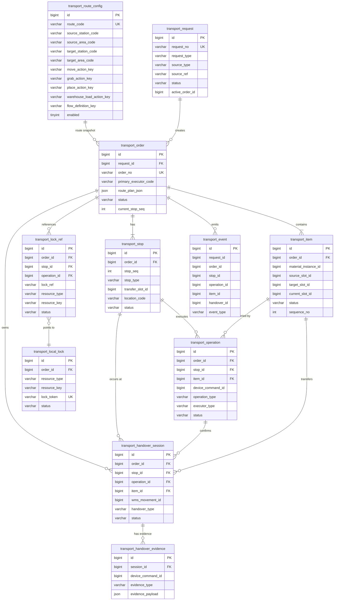
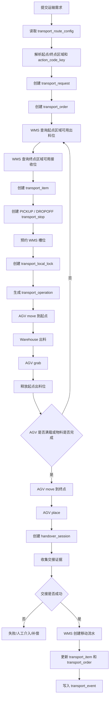
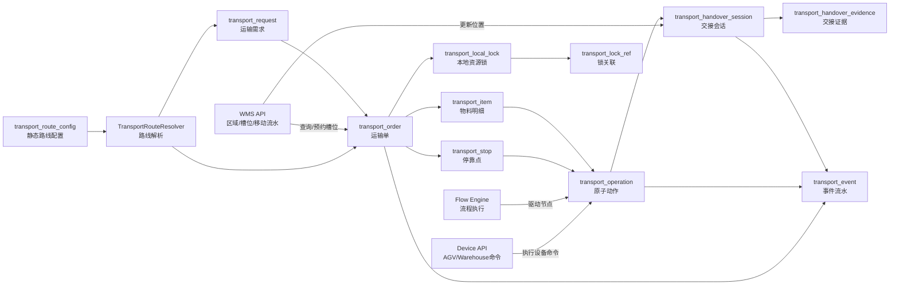

# Transport 关系与流程图

## 一、Transport ER 图



## 二、Transport 执行流程图



## 三、Transport 模块关系图



## 四、Transport 表的核心职责

```text
transport_route_config
    只保存静态路线规划

transport_request
    接收一次运输需求

transport_order
    承载一次可执行运输

transport_item
    承载运输的多批次物料

transport_stop
    描述起点、终点及中间停靠点

transport_operation
    描述 move、grab、place、warehouse transport 等原子动作

transport_local_lock
    记录 AGV、出料位、接收位等资源锁

transport_handover_session
    管理交出方和接收方确认

transport_handover_evidence
    保存扫码、传感器和设备回调证据

transport_event
    保存运输过程中的状态事件
```
